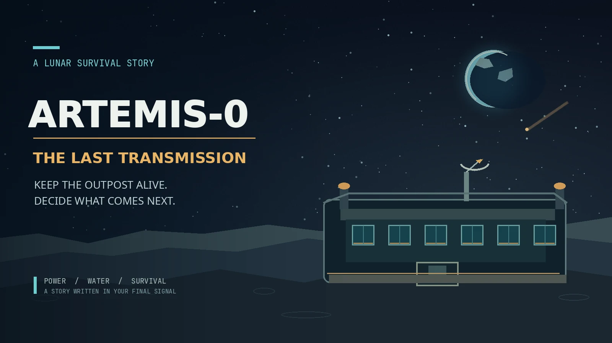

# Artemis-0: The Last Transmission



A standalone lunar-habitat survival story built for NASA Space Apps. Keep the
outpost alive, track an approaching asteroid, and choose your final transmission.
Optional equipment explanations and a mission debrief connect the game to real
engineering ideas.

**Platform:** Linux x86_64 first. **Engine:** Godot 4.7.2 stable, standard edition.
**Length:** approximately 10–20 minutes, depending on exploration and reading.

## Play in a browser

**[Play Artemis-0 online](https://artemis-0.vercel.app)** in a WebGL 2 desktop
browser. The `web/vercel` branch provides the browser build. See [WEB.md](WEB.md)
for local preview, Vercel deployment, and web-specific limitations. The browser
edition uses a bundled historical NASA catalogue without live refresh or
credentials.

## Play the Linux build

Extract `artemis-0-linux-x86_64.tar.gz`, open its folder, and run:

```sh
./artemis-0.x86_64
```

Keep `artemis-0.pck` beside the executable. No Godot installation is needed.
The default Forward+ renderer needs Vulkan-capable graphics and current drivers.
If Vulkan is unavailable, try `./artemis-0.x86_64 --rendering-method gl_compatibility`.

Start Mission opens the arrival briefing. Settings are saved locally; mission
progress lasts for the current run. The title and pause menus freeze the game.
Resource simulation also pauses while reading story transmissions.

## Controls

| Input | Action |
| --- | --- |
| WASD / mouse | Move / look |
| E | Interact with nearby equipment; close its panel |
| H / J | Eat / drink from available supplies |
| C | Resume the current transmission or read recent comms |
| Tab or O | Expand objectives while exploring |
| Esc | Close a panel; pause when no panel is open |
| F11 | Toggle fullscreen |
| Tab / Shift+Tab / Enter | Navigate menus and dialogue choices |

Sensitivity and master volume are available under **Controls & settings**.
Equipment uses dedicated panels; only the central operations consoles expose
all system tabs. See [INTERACTIONS.md](INTERACTIONS.md) for the room guide.

## Mission route

1. Start the **north-wall fuel cell**. Produce at least 0.50 kg water and reach
   22 EU of battery charge.
2. Inspect **west-wall food or stowage** and eat or drink. Preparing food and
   consuming it are separate actions.
3. At the **radar workstation**, acquire and transmit three successive locks.
   Adjust azimuth/elevation manually or use optional assisted calibration.
4. Keep power available for the final decision; resume an interrupted
   transmission with **C**. Mission choices are permanent within the run.
5. Read the epilogue and debrief, then replay or explore the station.

Warnings point toward recovery: start the fuel cell or use a backup power cell,
restore the CO₂ scrubber, eat rations, and drink stored water. A crew vital
reaching zero ends the mission with recovery advice and a replay option.

## Greenhouse and NASA catalogue

The **Lunar Greenhouse** sits on the west wall between food supplies and water
storage. Its dedicated panel manages planting, lights/misting, harvesting, eating
and condensate recovery. Central **Food** and **Greenhouse** tabs expose the same
state; the local food cabinet remains food-only.

- Two seed/nutrient kits start in the rack; Supply Crate Alpha holds two more.
- Each crop grows in **180 active seconds**, using **14.4 EU and 0.720 kg water**.
- **90%** is held as condensate; **10%** remains accounted for in crops/food.
  Recovering condensate uses **0.20 EU/kg** and requires free water-tank capacity.
- A harvest yields two portions, each restoring +35 hunger / +25 hydration.
  Growth rates, recovery fraction and nutrition effects are explicit game values.
- Plants contribute only a small amount to the abstract air-quality index. They
  do not refill gas tanks or replace the scrubber. Eating does not create oxygen.
- Seed kits are finite. Hot sauce in Alpha is flavour-only feedback.

Open **Science → NASA catalogue** to browse real Earth close approaches from
**November 14–15, 2010**. The bundled snapshot contains 29 records fetched from
NASA NeoWs. Every catalogue displays its retrieval timestamp and source status.
“Potentially hazardous” is a classification, not an impact prediction.
Real catalogue browsing cannot advance the fictional asteroid storyline.

The game starts with bundled/saved data and makes **no automatic network request**.
Use **Refresh historical catalogue from NASA** for an asynchronous update.
To enable refresh, set `NASA_API_KEY` in your environment or create `nasa.cfg` in
Godot's application user-data directory:

```ini
[api]
key="YOUR_OWN_NASA_API_KEY"
```

Keys stay outside the repository and exported game. Fetch failures, timeouts,
rate limits and malformed responses retain valid offline records. Refreshes have
a cooldown; validated responses are cached locally without API links or keys.

Maintainers can regenerate the bundled snapshot using
`python3 tools/update_neows_snapshot.py` with `NASA_API_KEY` set. The updater
keeps the previous snapshot if a request or validation fails.

## Build from source

Godot is pinned in `mise.toml`. With mise available:

```sh
mise install
mise exec -- godot --headless --editor --path . --import
mise exec -- godot --editor --path .
```

Press **F5** after imports finish. No third-party code packages are required.

For a Linux release, install the official **4.7.2 stable export templates** from
Godot's template manager, then:

```sh
python3 tools/package_linux.py
```

The script runs all three test suites, exports the game, tests the packaged executable,
and writes a tarball and SHA-256 checksum under `dist/`. Export settings are in
`export_presets.cfg`. Build artifacts, editor caches, development tools and
alternate asset formats are excluded from the playable package.

## Verification

```sh
mise exec -- godot --headless --path . --script tools/test_life_support.gd
mise exec -- godot --headless --path . --script tools/test_mission.gd
mise exec -- godot --headless --path . --script tools/test_greenhouse_api.gd
mise exec -- godot --path . --script tools/capture_release.gd -- /tmp/opencode
```

The checks exercise resource conservation and limits, food transactions,
equipment raycasts, scoped panels, storage transfers, all four story outcomes,
payment validation, dialogue resumption, stable controls during simulation,
objective milestones, failure/reset behavior, mission menus, greenhouse resource
accounting, and NASA catalogue validation and fallback behavior.

The capture helper renders menus, dialogue, storage, radar, learning content and
debrief at 1280×900 and 800×600, independent of window-manager tiling.

## Engineering model

`scripts/life_support_state.gd` owns shared resources; UI and world gauges
subscribe to it. This is an accelerated game model, not a hardware simulator.

- Fuel-cell mass ratio: **1 kg H₂ + 8 kg O₂ → 9 kg water**, rounded.
- Initial stores: 0.8/1 kg H₂, 6.4/8 kg O₂, 2/12 kg water, 20/100 EU.
- Full output: 0.005 kg H₂ + 0.040 kg O₂ per second produces 0.045 kg water
  and 0.50 EU. Inputs and available output capacity limit the same reaction.
- Electrolysis: 0.036 kg water + 0.60 EU per second produces 0.004 kg H₂ and
  0.032 kg O₂. Those gases yield only 0.40 EU when recombined: no free-energy loop.
- Breathing consumes oxygen independently of the powered CO₂ scrubber.
  **Air quality is an abstract 0–100 index, not oxygen concentration.**
- Fuel-cell reserve protection allocates 1.6 kg O₂ for other needs; it does not
  prevent crew respiration from consuming oxygen.
- Meals/drinks use finite packages and shared water. Ready-to-eat pouches need
  no added water. Storage contains finite emergency supplies.
- Water conditioning, food preparation and utility-item application are immediate.
  Heat, waste recovery, radiation shielding and solar generation are not simulated.

The story, characters, impactor, waveform displays and story orbital data are
fictional. The separate NASA catalogue contains real dated records, optionally
refreshed over HTTPS; it is not a live radar feed. The game does not represent a historical
NASA mission or imply NASA endorsement. The standalone story includes difficult
choices and loss; its optional science explanations can also support younger
learners with appropriate context.

## Team and sources

Created by **Rouwel Ngacha, Haji Ibrahim, Bernadette Akinyi and Richard Ochola**.
Rouwel leads story/gameplay, Haji owns life-support integration, Richard owns
NASA data/releases, and Bernadette owns UI/learning content and QA.
See [CREDITS.md](CREDITS.md) for identities, assigned responsibilities and asset
acknowledgments.

- [Smithsonian: Apollo astronaut life](https://airandspace.si.edu/explore/stories/apollo-astronaut-life)
- [NASA: Apollo fuel cells](https://www.nasa.gov/technology/tech-transfer-spinoffs/tech-today-nasas-moonshot-launched-commercial-fuel-cell-industry/)
- [NASA: Regenerative fuel-cell testing](https://www.nasa.gov/general/nasa-regenerative-fuel-cell-testing/)
- [NASA: Environmental control and life support](https://www.nasa.gov/reference/environmental-control-and-life-support-systems-eclss/)
- [NASA: Space Food Systems](https://www.nasa.gov/humans-in-space/space-food-systems/)
- [NASA: Open APIs / NeoWs](https://api.nasa.gov/)
- [CSA: Food production on the Moon and in remote areas](https://www.asc-csa.gc.ca/eng/youth-educators/toolkits/food-production/)
